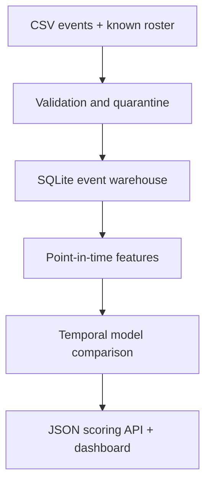

<div align="center">

# Telco Signal
### From raw events to an auditable inactivity forecast
**Data engineering · SQL · Temporal ML · Model monitoring · Local API**

</div>

An executable portfolio prototype inspired by Malika Fofana's B2B telecom data experience. It ingests events, quarantines invalid rows, builds point-in-time features and forecasts **zero activity over the next 30 days**. Includes a real dashboard and scoring endpoint.

**All data is synthetic. No Orange source code, customer data or proprietary model is included.** Prepared with AI-assisted engineering; validate your understanding using [WALKTHROUGH.md](WALKTHROUGH.md).

## Run it

Python 3.12. From this directory:

```bash
python3 -m venv .venv
source .venv/bin/activate
python -m pip install -r requirements.txt
python signal_pipeline.py
python -m unittest discover -v
python serve.py
```

Open http://127.0.0.1:8011. Dependencies are pinned to the environment used for the included report. No GPU, cloud account or API key is required. On Windows, activate with `.venv\\Scripts\\activate`.

## Architecture



| Layer | Implementation | Engineering evidence |
|---|---|---|
| Raw | Seeded 600-customer, 240-day simulation | CSV hash and declared generator assumptions |
| Validated | SQLite primary keys, parameterized inserts | Replay is idempotent; conflicts quarantined |
| Features | Six trailing-window features | Future events do not change features |
| Evaluation | Prior baseline, logistic regression, random forest | Chronological train / validation / test |
| Serving | Portable logistic JSON artifact | Validated feature schema; no pickle loading |
| Monitoring | PR-AUC, F1, Brier, feature PSI | Reports carry versions, thresholds and source hash |

## Executed result

The included run accepted **46,578 events**, ignored **10 repeated events**, and quarantined **2 invalid rows**. Replaying the file inserted **0 additional events**.

Validation selected **logistic regression**, with decision threshold **0.35**. Test PR-AUC: **0.628**, F1: **0.732**, precision: **0.642**, recall: **0.851**, Brier: **0.139**. These scores describe the authored simulator, not real customer performance. Full metrics and baseline comparison: [artifacts/report.json](artifacts/report.json).

## Data contract and temporal protocol

CSV: `event_id,customer_id,event_date,units`. Dates are ISO dates; units must be finite and nonnegative. Same event ID + same payload is a replay. Same ID + changed payload is a conflict. A zero-unit event still counts as an activity event under this demo contract; adapt the contract before using other event semantics.

At cutoff T, features use **[T−30,T)** and **[T−7,T)**. The label uses **[T,T+30)**. It equals 1 only if no event occurs and the coverage watermark confirms that the entire future window is observable. The fixed roster retains customers with no activity. Prediction does not require future coverage.

Training cutoffs: days 60, 90, 120; validation: 150; test: 180. Same customers appear over time, reflecting scoring of an existing fleet. Customer IDs are never model inputs. This protocol does **not** estimate generalization to unseen customers. Threshold maximizes validation F1; model selection uses validation PR-AUC; the test is read after those choices are fixed.

## API

```bash
curl http://127.0.0.1:8011/health
curl -X POST http://127.0.0.1:8011/api/predict \\
  -H 'Content-Type: application/json' \\
  -d '{"active_days_7":1,"active_days_30":8,"days_since_activity":5,"units_7":10,"units_30":120,"recent_share":0.0833333333}'
```

`GET /api/report` returns the experiment. `POST /api/predict` returns logistic risk and threshold. The API always names the serving model; a future experiment selecting a forest would not silently switch the JSON logistic endpoint.

## Scope and next experiments

This is a working **local batch prototype**. SQLite enables a laptop demonstration; distributed ingestion, orchestration, authentication, concurrent write handling and deployment load testing are not implemented. PSI reports distribution change, not proven model degradation. No confidence intervals or production calibration are claimed.

Next: evaluate a licensed public dataset with a compatible target; add backfill and late-arrival policies; benchmark DuckDB/Parquet; test customer-disjoint generalization; compare recall under an intervention budget. Those are future extensions, not current features.

